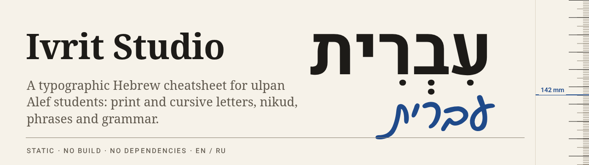
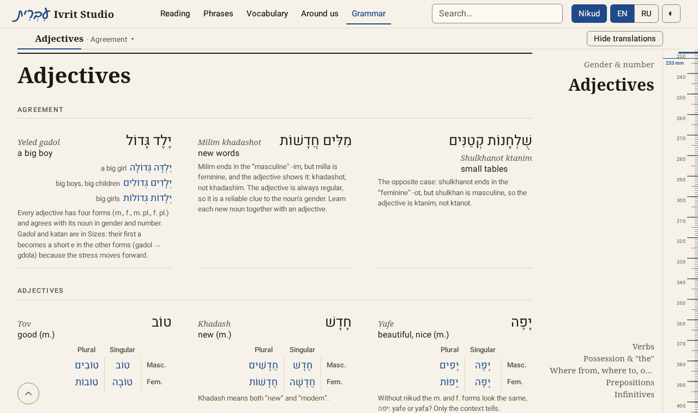
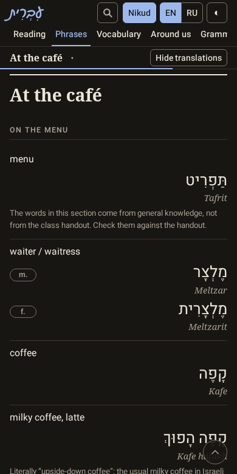

<div align="center">



[](https://github.com/yinon-mitin/ivrit-studio/actions/workflows/check.yml)
[](https://yinon-mitin.github.io/ivrit-studio/)
[](LICENSE)


**[Open the site →](https://yinon-mitin.github.io/ivrit-studio/)**

</div>

Ivrit Studio is a Hebrew cheatsheet for Alef-level ulpan students, set like a small reference book: warm paper, large Hebrew, hairline rules instead of cards. The goal is to read printed and handwritten Hebrew with nikud without stumbling, with a tidy reference always at hand.

It is a static site: HTML, CSS and ES modules, no build step, no framework and no runtime dependencies. Hosted on GitHub Pages.

<table>
  <tr>
    <td width="68%"></td>
    <td width="32%"></td>
  </tr>
</table>

## What is inside

Five parts, each one scrolling page, with the sections as headings and their groups as subheadings.

| Part | Sections |
|---|---|
| **Reading** | Alphabet (print and cursive, final forms, variants), nikud, final -akh (furtive patah), geresh and double vav |
| **Phrases** | Small talk, getting to know someone, the market, a courier, neighbours, the café, the airport. Masculine and feminine forms share one card |
| **Vocabulary** | Everyday words, family, numbers, days and time, colours, sizes, directions, abbreviations, peoples and places, countries and languages |
| **Around us** | Objects, animals, the home and the safe room, the kitchen, fruit and vegetables |
| **Grammar** | Pronouns, gender and number, adjectives, present-tense verbs, possession, where from and where to, prepositions, infinitives |

All entries are unverified until the author checks them (see [Checking nikud](#checking-nikud)).

## Features

- **Nikud on / off** to test your reading. The alphabet keeps its dagesh and shin/sin dots.
- **EN / RU** switches the interface and every translation. English is the default.
- **Hide translations** blurs readings and meanings; tap one to check yourself.
- **Search** across all sections by Hebrew with or without nikud, by reading, or by English or Russian meaning. Press `/` to focus it.
- **Light and dark theme**, following the system or picked by hand.
- **A millimetre ruler** (laptop) as the page's scrollbar: real CSS millimetres that move 1:1 with the page, a marker with the position in mm, a mark per section. It travels on the compositor, in the same frame as the page, wherever the browser supports scroll-driven animations.
- **Flowing section titles** beside the ruler on wide screens, after [getartcraft.com](https://getartcraft.com).
- **Print** a part on A4: black on white, everything shown.
- **Installable** on a phone as an app (manifest, icons, an install hint on the second visit).
- **Fast and private**: first load ≤ 200 KB, no external requests, no analytics, self-hosted fonts.

## Getting started

```sh
npm install                              # dev dependencies only (Playwright, axe)
npx playwright install chromium webkit   # browsers for e2e

npm run serve        # http://localhost:8000
npm test             # unit tests
npm run check:fast   # after edits
npm run check:task   # before every commit
npm run check:full   # before push (adds webkit, Semgrep, osv-scanner)
node scripts/make-icons.mjs   # redraw the app icons (letter א in Heebo); the PNGs are committed
```

Node 26 is used for development (`node:test` with built-in coverage). Nothing is needed to run the site itself except a static file server.

## Using the site

- **Contents** (`#/`) lists the five parts and their sections. The header always shows the parts.
- **The bar under the header** on a part page names the section you are reading. Tap it to jump to another section or group. It also holds **Hide translations**.
- **The ruler** at the right edge (laptop, long pages) replaces the browser's scrollbar. Drag it to move the page, click a point to bring it to the reading line, or focus it and use the arrow keys, Page Up/Down, Home and End.
- **Section titles** beside the ruler (wide screens) flow as you scroll. Click one to go there.
- **◐** cycles the theme: auto, light, dark.

## Changing content (data only, no code)

Content lives in `data/`. The **Data Contract** section of [`SPEC.md`](SPEC.md) is all the context needed.

- **New entry:** add it to `data/sections/<id>.json`. In a section with groups, give it a `group`. Ids are `<section>.<slug>` and are never renamed. New entries are `"verified": false`.
- **New section:** add `data/sections/<id>.json` and put its id in the `sections` of one part in `data/index.json`.
- Run `node scripts/validate.mjs`, then `npm run check:task`, then commit the data alone and push.

### Checking nikud

Every entry starts as `"verified": false`, and the validator prints how many are still unchecked. Check the Hebrew with [Dicta Nakdan](https://nakdan.dicta.org.il/) and ask the teacher when in doubt. Only then set `"verified": true`.

## Quality bar

[`CONSTRAINTS.md`](CONSTRAINTS.md) is the bar a change must clear before it is committed, enforced by `npm run check:task` and by CI:

- no skipped, focused or deleted tests, no suppression comments, no secrets (floor guard and gitleaks)
- unit tests for the pure `assets/js/core/` modules with coverage thresholds (lines ≥ 90 %, branches ≥ 80 %, functions ≥ 90 %)
- Playwright end-to-end tests at 360×640, 390×664 and 1280×720: no horizontal overflow, zero critical or serious axe violations in both themes, first load ≤ 200 KB, each font ≤ 60 KB, no external requests
- Semgrep and osv-scanner in `check:full` and CI

## Project layout

```
index.html                 the single page
manifest.webmanifest       install as an app
assets/css/app.css         design tokens, layout, views, print
assets/js/                 main.js, ui/, views/, loader.js, storage.js
assets/js/core/            pure modules (routing, search, nikud, schema); covered by unit tests
assets/fonts/              Heebo and Gveret Levin (woff2, subset)
data/index.json            parts and the order of their sections
data/sections/<id>.json    one file per section
scripts/                   validator, floor guard, icon and font tools
tests/unit, tests/e2e      node:test and Playwright
```

More: [`SPEC.md`](SPEC.md) (what to build and the data contract), [`CONSTRAINTS.md`](CONSTRAINTS.md) (quality bar), [`tasks/plan.md`](tasks/plan.md) (implementation plan).

## Publishing

The site is static and has no build step. On GitHub, go to **Settings → Pages → Deploy from a branch → `main` / `(root)`**. The site appears at `https://<user>.github.io/ivrit-studio/`. CI (`.github/workflows/check.yml`) only runs the checks.

## Fonts

Self-hosted, subset to Hebrew with nikud, Basic Latin and punctuation (`npm run fonts`, which downloads from [google/fonts](https://github.com/google/fonts) at a pinned commit). Latin headings use the system serif, so nothing else is downloaded.

- **Heebo** by Oded Ezer (print and interface), weights 400–700, SIL Open Font License 1.1 ([`assets/fonts/OFL-Heebo.txt`](assets/fonts/OFL-Heebo.txt))
- **Gveret Levin** by AlefAlefAlef (cursive), SIL Open Font License 1.1 ([`assets/fonts/OFL-GveretLevin.txt`](assets/fonts/OFL-GveretLevin.txt))

## License

Code: MIT (see [`LICENSE`](LICENSE)). Fonts: SIL OFL 1.1 (see above).
