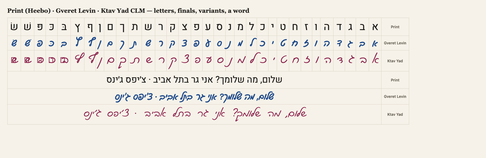
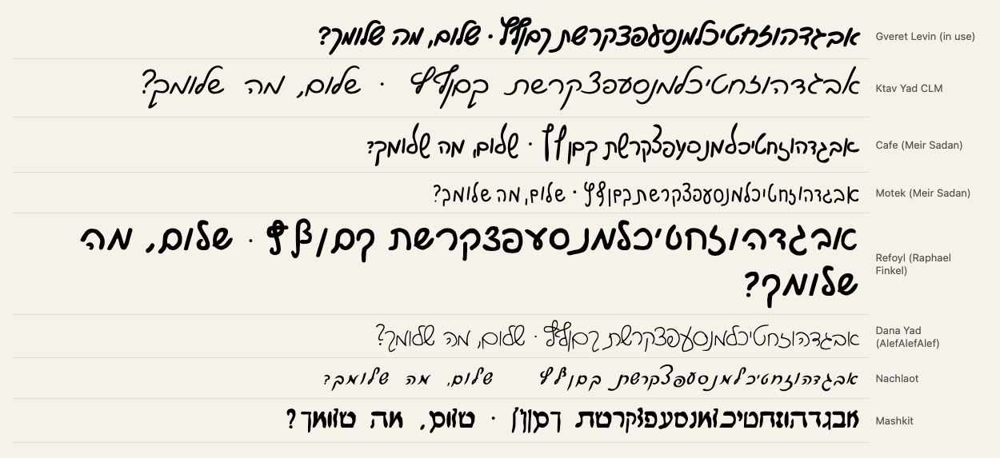

# Spike: a second cursive font (Task 4, 2026-10-20)

**Verdict (updated): four usable second cursives. Refoyl is the strongest (nikud, GPL+FE); Ktav Yad has the lightest school look. Owner picks.**

## Candidates (searched again, owner: "search deeper")

Where I looked: the Google Fonts catalogue (all Hebrew families), the Open Siddur Project's open Hebrew font pack (github.com/aharonium/fonts, 396 font files) and its LICENSES.txt, the Culmus "fancy" fonts, github.com/johnlockejrr/hebrew_cursive_fonts, Awesome-Hebrew-Fonts, Israeli free-font sites (freefonts.co.il, fontup, AlefAlefAlef), and web search in English and Hebrew.

| Font | Style | License (read from the files) | Nikud / dagesh | Verdict |
|---|---|---|---|---|
| Gveret Levin (AlefAlefAlef) | modern cursive, marker | OFL 1.1 | yes | in use |
| **Ktav Yad CLM** (Maxim Iorsh, Culmus) | light school cursive | GPL-2, no font exception | **no** | usable |
| **Refoyl** (Raphael Finkel / Refoyl Finkl) | bold modern cursive | No license in the file. Open Siddur's LICENSES.txt: the author let them distribute it under a license of their choice; they ship it as **GPL + font exception** | **yes**: dagesh, shin/sin dots, vowels | usable; the cleanest license of the three |
| **Cafe** (Meir Sadan, 1998–2003) | thin pen cursive | **CC BY-NC-ND 1.0**: non-commercial and no derivatives, so it must be served unmodified (33 KB TTF, no subsetting) | no | possible for a free study site; strict |
| **Motek** (Meir Sadan) | rounded thin cursive | CC BY-NC-ND 1.0 (as Cafe), 20 KB TTF | no | possible, as Cafe |
| Dana Yad (AlefAlefAlef) | modern cursive | AlefAlefAlef EULA: "property of AlefAlefAlef", no redistribution | — | out |
| Nachlaot | cursive | The file says "Copyright 1991, Atech Software … converted from DAVKA NACHLAOT": a converted commercial font, open status unclear | partial | out (provenance) |
| Playpen Sans Hebrew | handwritten **print** | OFL | yes | not cursive |
| Solitreo | historical Sephardic/Ladino cursive | OFL | — | not modern cursive |
| Mashkit, Amatic SC, others | print-like | various | — | not cursive |

So there are **four usable second cursives**: Ktav Yad CLM, Refoyl, Cafe and Motek. Refoyl is the only one with nikud and dagesh, which matters for the alphabet's variants (בּ כּ פּ שׁ שׂ).

## Ktav Yad CLM
| | |
|---|---|
| Source | https://culmus.sourceforge.io/fancy/ → `ktav-yad.zip` (OTF + SFD source + GNU-GPL), version **1.01** (2024-02-05), sha256 `83d0a9bbf397b061f227d7585843f95e0ac3f3a31f48c3a1274dc7345325b1e7` |
| Styles | MediumItalic, BoldItalic (the spike used MediumItalic) |
| License | "Copyright (c) 2002-2024 by Maxim Iorsh. Distributed under the terms of GNU General Public License version 2." Version 1.01 removed the embedding restriction. The zip has **no font exception**, unlike the core Culmus fonts. |
| What shipping it needs | Commit the woff2 with `GNU-GPL` and a notice (copyright, upstream URL, pointer to the SFD source). It is a separate work next to MIT code; the site serves it as a file and does not link it into code. Printing to PDF embeds a subset. For personal study sheets this is the normal use of a GPL font, but without a font exception a strict reading puts redistributed PDFs under the GPL. |
| Glyphs | All 27 letters (22 + 5 finals), geresh, gershayim, maqaf, Basic Latin. 55 glyphs. |
| Missing | **No nikud, no dagesh, no shin/sin dots**, no mark positioning (no GPOS `mark`). בּ כּ פּ שׁ שׂ render as broken boxes (see the screenshot). |
| Size | OTF 23 KB → woff2 subset (Hebrew letters + geresh/gershayim/maqaf + Basic Latin) **15 KB** (limit 60 KB) |
| Look | A light, upright-leaning school cursive, closer to everyday handwriting than Gveret Levin's marker style. Words read naturally. |

## If go: how Task 5 would use it
- The alphabet's "rows" group becomes **"Two cursive styles / Два почерка"**: print, Gveret Levin and Ktav Yad stacked, right to left.
- The second style draws **base letters only**. The dagesh and shin/sin variants show the base letter (בּ → ב), because the marks would break. Handwritten cursive usually leaves them out anyway; the first style still shows them.
- Loaded only where used (`font-display: swap`, Hebrew unicode-range); first load unchanged.
- `scripts/subset-fonts.sh` downloads the zip at the pinned version above and checks the sha256.

## If no-go: alternatives
1. **Cursive only:** cursive letters without print; the print letter shows on tap (like Hide translations). This is a reading self-check.
2. **Words in cursive:** real words and phrases in print and cursive, for reading whole words.
